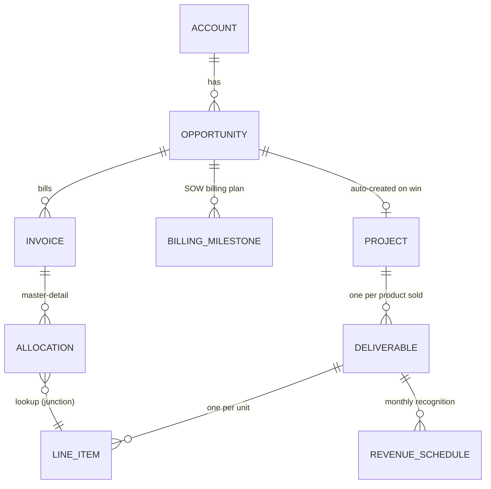
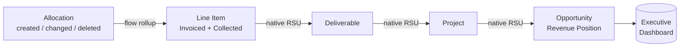

# Salesforce Finance Layer

**An interim revenue and billing architecture built entirely on Salesforce Enterprise Edition — no paid add-ons, declarative-first, designed to retire cleanly at ERP cutover.**

> **About this repository.** This is a public, re-authored case study of real consulting work I delivered for an analytics company. Every component here was rebuilt from the architectural intent: no client code, data, names, or figures appear anywhere in this repository. All numbers are illustrative.

---

## The problem

The client was 12 months away from an ERP migration, but Finance needed answers *now*:

- What have we invoiced, collected, earned, and deferred — **per deal, live**?
- What does the SOW say we *will* bill, and does that plan reconcile to the contract?
- How does revenue recognize month by month as work is delivered?
- Can leadership see all of it on one dashboard without asking anyone?

The constraints made it interesting:

| Constraint | Consequence |
|---|---|
| Enterprise Edition only, no Revenue Cloud or CPQ budget | Everything built from platform primitives |
| ERP migration ~12 months out | Interim by design: composable, swappable, low migration debt |
| Small admin team post-handoff | Declarative-first: Flow over Apex wherever the platform allows |
| Finance needs management-grade numbers, not audit-grade | Revenue recognition = forecasting model, not ASC 606 compliance (that lives in the ERP) |

## What was built

1. **Invoicing & collections** — invoice records created from the deal via a guided action, allocated many-to-many across deliverable line items, with collection tracking and **automatic status transitions** (Draft → Partially Paid → Paid) driven by roll-ups.
2. **A live Revenue Position on every deal** — eight always-current figures: Contracted, Recognized, Invoiced, Paid, Accounts Receivable, Unbilled, Deferred, Remaining.
3. **Planned billing schedules** — the SOW's billing milestones per deal, continuously reconciled against the contract amount, with a mismatch flag and a finance work queue.
4. **Automated revenue recognition schedules** — set one date on a deliverable and the engine generates its monthly schedule: straight-line over 12 months, day-prorated partial first and final periods, rounding remainder in the final month, always summing exactly to the deliverable's value.
5. **Payment terms** — set once per account, driving expected payment dates on invoiced work.
6. **Delivery-driven earnings** — marking line items delivered recognizes revenue at line grain; a deliverable flips to Delivered only when all its units are.
7. **Stage-gate governance** — legal/finance review requirements enforced at the right pipeline stage, including for records created directly at a gated stage (a subtle platform trap — see the [engineering notes](docs/engineering-notes.md)).
8. **An executive dashboard** — ten tiles reading only governed data, every tile's source report independently cross-checked against SOQL to the cent.

## Architecture



The financial figures cascade up a native roll-up chain — **Line Item → Deliverable → Project → Opportunity** — one roll-up per level, because native roll-up summaries span exactly one master-detail hop. Where a master-detail relationship was impossible (the invoice junction meets the platform's 3-level master-detail ceiling at the line item), the roll-up is **flow-based**, driven by a subflow invoked from after-save and before-delete triggers, and self-healed nightly by a schedule-triggered reconciliation flow.



Full detail, including every design decision and its trade-offs: [docs/architecture.md](docs/architecture.md).

## Design decisions worth stealing

| Decision | Why |
|---|---|
| Junction object with **Lookup + flow roll-ups** instead of master-detail | The delivery chain already uses all 3 master-detail levels; the platform won't allow a 4th. Flow roll-ups measured bulk-safe: ~3 queries / 2 DML per 200-row batch. |
| **Screen flow** for guided record creation instead of lookup filters or predefined values | Lookup filters can't traverse the needed relationship depth, and create-action predefined values can't set a lookup from a formula (deploy-time platform error). |
| **Recognition engine in Apex** — the one justified exception to declarative-first | Day-prorated period math with exact-sum guarantees needs iteration and rounding control Flow can't express cleanly. Covered by its own test suite. |
| Auto-status as a **before-save flow on the parent**, fired by roll-up recalculation | Roll-up summary recalculation re-fires the parent's automation — so a child change updates the parent status with zero extra queries. |
| **All-or-nothing delivery roll-up** | A deliverable flips to Delivered only when delivered units equal quantity. Partial delivery still earns revenue at line grain — status and money deliberately decoupled. |
| **Interim by design** | Each capability is a self-contained unit (own objects, flows, permission set) that can be switched off or exported at ERP cutover without touching the sales pipeline. |

## Outcomes (illustrative, but representative)

- Production go-live executed in staged deployments with full data backups, rollback artifacts, and in-production self-cleaning smoke tests — **all green on day one**.
- A **70+ product catalog** realigned (renames, SKU series, retirements) with zero loss of deal history, proven by an automated diff against the approved source table.
- **10-tile executive dashboard** with every tile's report cross-checked against independent queries — one inherited defect found and fixed *before* leadership ever saw a wrong number.
- End-to-end certification performed by the client in UAT: invoice lifecycle, allocations, collections, auto-statuses, recognition schedules — **every figure verified to the dollar**.

## What this repository includes

The docs describe the original build in full. A few parts of that design are described but not re-authored in `force-app/`:

| Described in the docs | In this repository |
|---|---|
| Invoice with Private sharing, a lookup filter to the account's deals, and an external ID | Invoice uses Read/Write sharing; no lookup filter or external ID |
| Audit fields on revenue schedule rows (method, version, run ID) | Not included; rows carry amount, dates, period type and recognized days |
| Stage-gate validation rules for legal and finance review | Described in the engineering notes; the rules are not included |
| A finance work-queue list view | Not included |

Everything listed under "Verification status" below was deployed and tested from this repository's contents.

## Repository contents

| Path | What it is |
|---|---|
| [docs/architecture.md](docs/architecture.md) | The data model, roll-up mechanics, recognition math, and every trade-off |
| [docs/engineering-notes.md](docs/engineering-notes.md) | The gotcha catalog: platform behaviors that cost real hours, so they don't cost you any |
| [SECURITY.md](SECURITY.md) | How to report a security issue privately |
| [docs/runbook-patterns.md](docs/runbook-patterns.md) | Operational patterns: safe production data loads, flow activation via Tooling, Analytics REST rebuilds |
| `force-app/` | Re-authored, deployable source (objects, fields, flows, Apex engine + tests, permission set) |
| `scripts/` | Scratch-org setup, demo data seeding, Analytics REST builders, and the anonymization scrub check |

## Try it in ten minutes

```bash
./scripts/setup-demo.sh --scratch [your-devhub-alias]   # or: ./scripts/setup-demo.sh <existing-org-alias>
sf org open --target-org finance-layer-demo
```

The script deploys the full source, runs the Apex test suite, and seeds a demo deal ("Acme Growth Program") whose **every figure is asserted by the seed itself** — if a number can't be verified, the setup fails loudly. Then open the deal and explore: the Revenue Position, the billing milestones, the invoice with its allocations and auto-status, and the deliverable's monthly recognition schedule.

**Verification status:** the exact contents of this repository deploy green to a fresh scratch org (98/98 components), pass the test suite (5/5), and seed with all assertions passing.

## Related

[salesforce-revenue-recognition](https://github.com/marilometa/salesforce-revenue-recognition) — the earlier, narrower predecessor of this work: declarative patterns for the post-Closed Won handoff, deliverables and payment schedules. This repository tells the full finance-layer story. The two are separate references and are not meant to be installed in the same org: some names overlap with different meanings, for example `Project__c.Opportunity__c` is a master-detail here and a lookup there.

## License

MIT — see [LICENSE](LICENSE). Built by Marilo Meta, Salesforce MVP · Application Architect · 21x Certified.
